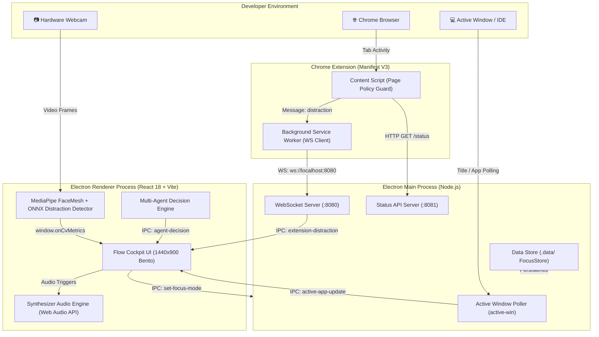
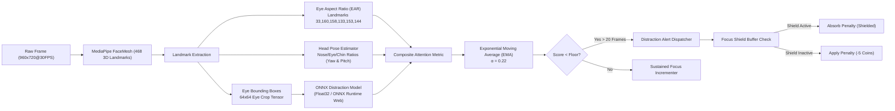
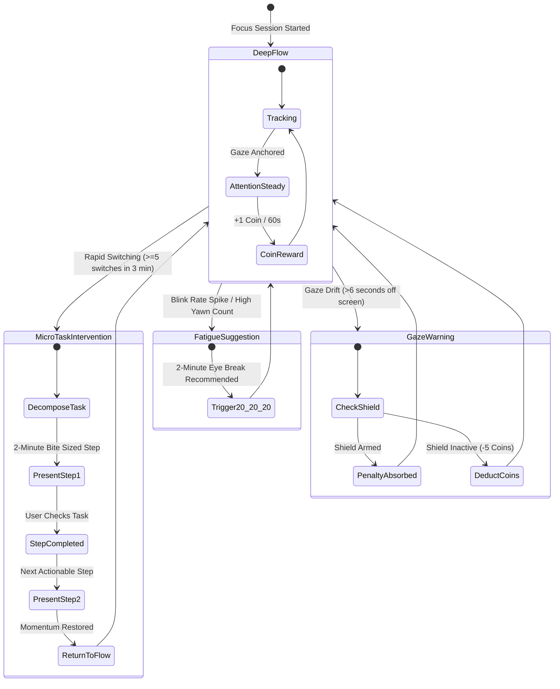
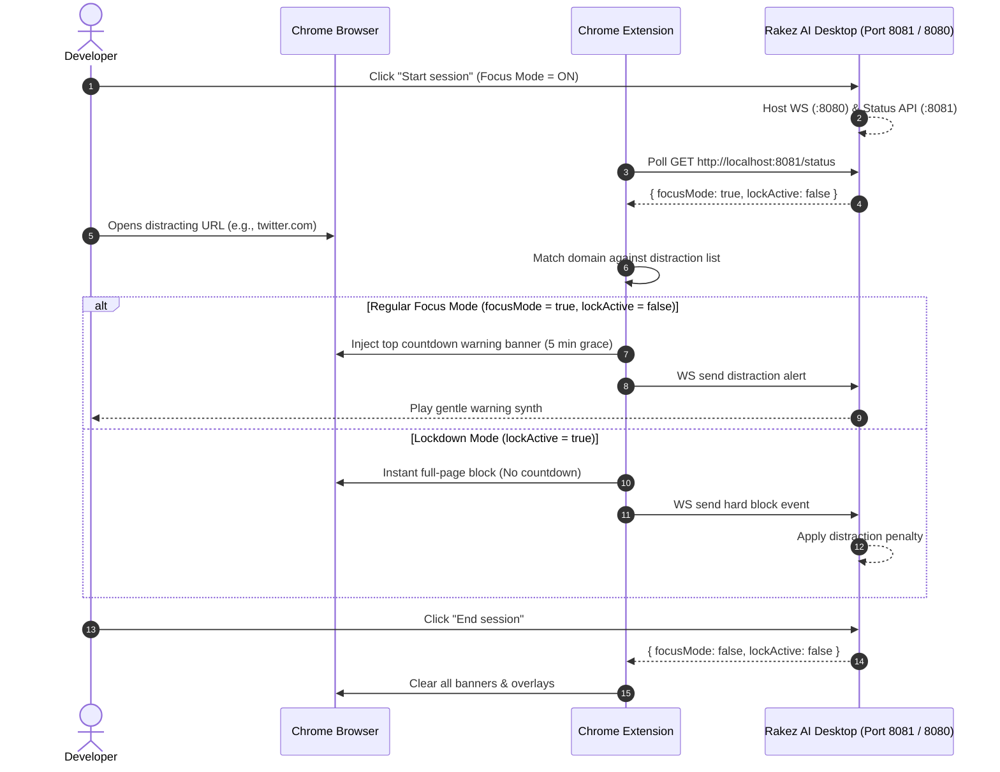

# Rakez AI — Neural Flow Command Center 🛡️🧠

<p align="center">
  
  
  
  
  
  
</p>

<p align="center">
  <strong>Autonomous on-device vision intelligence & multi-agent cognitive coaching designed to protect deep developer flow.</strong>
  <br />
  <em>Zero cloud telemetry • Local edge inference • Real-time distraction shielding • Chronobiological insights</em>
</p>

---

## 📑 Table of Contents

- [Overview](#-overview)
- [Cockpit Bento Snapshot](#-cockpit-bento-snapshot)
- [System Architecture](#-system-architecture)
  - [1. High-Level System Topology](#1-high-level-system-topology)
  - [2. On-Device Edge Computer Vision Pipeline](#2-on-device-edge-computer-vision-pipeline)
  - [3. Multi-Agent Cognitive Intervention Cycle](#3-multi-agent-cognitive-intervention-cycle)
  - [4. Desktop-to-Extension Communication Protocol](#4-desktop-to-extension-communication-protocol)
- [Core Feature Set](#-core-feature-set)
- [Mathematical Models & Metrics](#-mathematical-models--metrics)
- [Directory Structure](#-directory-structure)
- [Setup & Installation](#-setup--installation)
- [Chrome Extension Configuration](#-chrome-extension-configuration)
- [Interactive LinkedIn Demo Studio](#-interactive-linkedin-demo-studio)
- [Validation & Test Suite](#-validation--test-suite)
- [Privacy & Security Guarantee](#-privacy--security-guarantee)
- [License](#-license)

---

## 🌟 Overview

Modern software development requires intense cognitive focus. Frequent context switching, urgent messages, and algorithmic rabbit holes shatter deep developer flow states. Research shows it takes over **23 minutes** to regain focus after a single distraction.

**Rakez AI** is an intelligent desktop application and browser extension ecosystem that actively safeguards cognitive momentum. It combines:
1. **Local Computer Vision (MediaPipe FaceMesh + ONNX Runtime Web)** to detect physical gaze drift and ocular fatigue in real time without sending a single frame to the cloud.
2. **OS Active-Window Telemetry** to track active IDE files, terminals, and context switches.
3. **Multi-Agent Intervention Engine** that decomposes overwhelming tasks into actionable 2-minute micro-steps when hesitation or task-switching is detected.
4. **Chrome Extension Shield** with adaptive countdown warnings and hard lockdown modes.
5. **Gamified Flow Economy** rewarding sustained focus minutes with Focus Coins that purchase distraction immunity shields.

---

## 📐 Cockpit Bento Snapshot

The desktop UI features a pixel-perfect, dark-mode 12-column × 3-row Bento Grid layout (1440 × 900) styled in precision `#0A0C11` with `#12151C` card surfaces, `#5EEAD4` teal flow accents, and JetBrains Mono metrics:

```
┌────────────────────────────────────────────────────────────────────────────────────────────────────────┐
│  🛡️ Rakez AI    [Cockpit] [Analytics] [Event log] [Settings]       ● Ext Linked  Vision On-Device  🪙 248  │
├─────────────────────────────────────────────────────────────────┬──────────────────────────────────────┤
│  CARD 1: FLOW COMMAND CENTER (Cols 1-7, Rows 1-2)               │  CARD 2: FOCUS SHIELD (Cols 8-12, R1) │
│                                                                 │  Armed • 07:42 left of 10 min        │
│   ╭──────────────╮   Deep flow.                                │  [████████████████████░░░] 77%       │
│  │    47:12     │   Keep going.                               │  Blocks -5 penalty • [Extend: 20 🪙] │
│  │ of 63m goal  │   Attention steady 31 min. Shield armed.    ├──────────────────────────────────────┤
│   ╰──────────────╯   [End Session]  [Lock 25 min]               │  CARD 3: LIVE ATTENTION (Cols 8-12, R2│
│                                                                 │   /\    /\__/\    Processed locally  │
│  ┌──────────┬──────────┬──────────┬──────────┐                  │  /  \__/      \___/\ (Smooth Wave)   │
│  │  3h 12m  │    4     │   92%    │   +37    │                  │  EAR: 0.31 | Pitch: -4° | Yaw: 6°    │
│  │Focus Day │Distract. │Attention │Coins Won │                  │  ⚠️ Fatigue creeping in (2m break)   │
│  └──────────┴──────────┴──────────┴──────────┘                  │                                      │
│  Active App: Visual Studio Code — rakez/main.js [coding • 94%]  │                                      │
├──────────────────────────────────┬──────────────────────────────┴───────┬──────────────────────────────┤
│  CARD 4: AGENT DECISION (C1-5,R3)│  CARD 5: DISTRACTION LOG (C6-9, R3)  │  CARD 6: FOCUS BY HOUR (C10) │
│  set_micro_tasks                 │  14:32  [cv]     Gaze off 6s  shield │   ▂ ▃ ▅ █ ▇ █ ▆ ▄ ▂  (24h)   │
│  Rapid switching detected (5/3m).│  14:21  [ext]    x.com block  -5     │  Peak window: 9-11 AM        │
│  ☑ Open failing test             │  14:05  [reward] 25m streak   +10    │  Slack is your top trigger   │
│  ☐ Write 1 console.log           │  13:48  [shop]   Shield armed -20    │                              │
│  ☐ Commit what works             │                                      │                              │
└──────────────────────────────────┴──────────────────────────────────────┴──────────────────────────────┘
```

---

## 🏛️ System Architecture

### 1. High-Level System Topology



---

### 2. On-Device Edge Computer Vision Pipeline

The vision pipeline runs entirely inside the client process via WebAssembly and WebGL. **No video frames or image buffers are ever saved to disk or transmitted over the network.**



---

### 3. Multi-Agent Cognitive Intervention Cycle

Rakez AI tracks behavioral entropy (rapid window switches, hesitations, task abandonment) and deploys adaptive interventions:



---

### 4. Desktop-to-Extension Communication Protocol



---

## ⚡ Core Feature Set

- **100% On-Device Computer Vision**: Runs MediaPipe FaceMesh (468 landmarks) combined with custom ONNX deep learning distraction weights entirely inside WebAssembly/WebGL. Zero frames leave your local machine.
- **Dynamic Eye Aspect Ratio (EAR)**: Continuously evaluates eyelid aperture and horizontal/vertical gaze vectors.
- **Biometric Head Pose Estimation**: Computes rotational pitch and yaw degrees to distinguish between looking at secondary monitors vs. complete distraction.
- **Neural Focus Shield**: A gamified buffer that absorbs distraction penalties for 10 minutes when purchased with accumulated Focus Coins.
- **Intelligent Micro-Task Staging**: Breaks overwhelming coding problems into 2-minute actionable steps when cognitive paralysis or rapid tab-switching is detected.
- **Chronobiological Focus Heatmap**: Aggregates hourly attention density across a 24-hour cycle to identify peak biological productivity zones.
- **Browser Lockdown Policy (Chrome Extension)**:
  - *Standard Focus Mode*: Injects non-intrusive countdown warnings before hard-blocking blacklisted sites.
  - *Lockdown Mode*: Bypasses warnings and locks distracting domains instantly.
- **Synthesizer Audio Feedback**: Pure Web Audio API procedural sound engine with spatial flow chimes, reward rings, and subtle ambient alert sweeps.

---

## 🔬 Mathematical Models & Metrics

### Eye Aspect Ratio (EAR)
Evaluated across six 3D landmarks for both left and right ocular regions:

$$\text{EAR} = \frac{||p_2 - p_6|| + ||p_3 - p_5||}{2 \cdot ||p_1 - p_4||}$$

Where $p_1, \dots, p_6$ represent eyelid and canthus landmark coordinates.

### Head Yaw & Pitch Pose Ratios
Calculated using ocular distance $D_{\text{eye}} = |x_{\text{right}} - x_{\text{left}}|$ and vertical facial height $H_{\text{face}} = |y_{\text{bottom}} - y_{\text{top}}|$:

$$R_{\text{yaw}} = \frac{x_{\text{nose}} - \min(x_{\text{left}}, x_{\text{right}})}{D_{\text{eye}}}, \quad R_{\text{pitch}} = \frac{y_{\text{nose}} - y_{\text{top}}}{H_{\text{face}}}$$

### Attention Score Smoothing (EMA)
To prevent erratic single-frame jumps, raw attention metrics are filtered via Exponential Moving Average:

$$S_t = \alpha \cdot S_{\text{raw}} + (1 - \alpha) \cdot S_{t-1} \quad (\alpha = 0.22)$$

---

## 📂 Directory Structure

```text
focus-guardian/
├── ai/
│   ├── distractionDetector.js     # MediaPipe FaceMesh + ONNX edge inference pipeline
│   ├── distraction_model.onnx     # Quantized local neural network model
│   └── distractionWorker.js       # Background web worker for parallel tensor processing
├── electron/
│   ├── main.js                    # Window management, active-win tracker, WS (:8080), API (:8081)
│   ├── preload.js                 # Context-isolated secure IPC bridge
│   └── ui/                        # Fallback legacy lightweight UI
├── extension/
│   ├── manifest.json              # Chrome Manifest V3 configuration
│   ├── background.js              # Service worker connecting to desktop WebSocket
│   ├── content.js                 # DOM overlay enforcement & countdown injection
│   └── content.css                # Polished glassmorphic block page styles
├── renderer/
│   ├── index.html                 # Modern entry point (Inter & JetBrains Mono font imports)
│   └── src/
│       ├── main.jsx               # React 18 application bootstrapper
│       ├── styles.css             # High-precision 1440x900 Bento grid CSS specifications
│       ├── components/
│       │   └── FocusDashboard.jsx # Flow Command Center (Cockpit, Analytics, Telemetry, Settings)
│       └── utils/
│           └── soundEngine.js     # Procedural Web Audio API sound generator
├── scripts/
│   ├── validate-mvp.js            # Automated verification test suite
│   └── validate-false-positives.js# Metric calibration and threshold test suite
├── package.json                   # NPM script orchestration & dependencies
└── run-app.bat                    # Automated one-click desktop launcher (Windows)
```

---

## 🚀 Setup & Installation

### Prerequisites
- **Node.js**: v18.0.0 or higher (v22+ recommended)
- **NPM** or **PNPM**
- Built-in or external USB webcam

### 1. Clone & Install Dependencies
```bash
git clone https://github.com/welba/rakez-ai.git
cd rakez-ai
npm install
```

### 2. Build Renderer & Launch Desktop App
To build the modern React 18 client and launch Electron:
```bash
npm start
```
*On Windows, you can also double-click `run-app.bat`.*

---

## 🔌 Chrome Extension Configuration

1. Open Google Chrome and navigate to `chrome://extensions/`.
2. Toggle on **Developer mode** in the top-right corner.
3. Click **Load unpacked**.
4. Select the `extension/` folder in this repository.
5. The extension icon will appear in your toolbar and automatically connect to `ws://localhost:8080`.

---

## 🎬 Interactive LinkedIn Demo Studio

Rakez AI includes a built-in **Demo Studio** specifically designed for screen recording video presentations and LinkedIn showcases:

1. Launch Rakez AI (`npm start`).
2. In the top-right header, click **`🎬 Demo Studio`**.
3. A sleek floating control strip will expand with instant triggers:
   - **⚡ Peak Flow Surge**: Demonstrates deep focus (attention surges to 96%, +5 coins awarded, coin chime plays).
   - **🚨 Simulate Gaze Drift**: Demonstrates edge AI drift detection, logs the incident, and plays an alert.
   - **🛡️ Arm Focus Shield**: Demonstrates the 10-minute penalty absorption buffer.
   - **☕ Rest Nudge (20-20-20)**: Simulates ocular fatigue recommendations.
   - **🎯 Calibrate Vision**: Runs a 12-second facial landmark calibration overlay.

---

## 🧪 Validation & Test Suite

Rakez AI contains an automated validation suite verifying core IPC events, WebSocket handshakes, and false-positive resilience:

```bash
# Run all tests
npm run validate:all

# Test core MVP contracts
npm run validate:mvp

# Test false-positive tolerance & cooldown thresholds
npm run validate:false-positives
```

---

## 🔒 Privacy & Security Guarantee

- **Zero Cloud Video Ingestion**: Webcam frames are analyzed locally in ephemeral frame buffers inside the browser sandbox. No images or video streams are ever stored on disk or transmitted over HTTP/WebSockets.
- **Local SQLite/JSON Storage**: All stats, calibration baselines, and logs are stored locally in the application's isolated `.data/` directory.
- **Fail-Open Policy**: If the desktop application is closed or offline, the Chrome extension defaults to unrestricted browsing without blocking.

---

## 📄 License

Distributed under the MIT License. See `LICENSE` for details.

---

<p align="center">
  Built with ❤️ for deep thinkers and engineers by <strong>Rakez AI</strong>.
</p>
